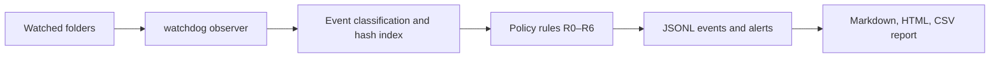

# Secure File Transfer Monitoring System

A small defensive file monitoring tool for recording filesystem activity, identifying sensitive-file movement, comparing SHA-256 hashes, and producing an audit report. The demo uses synthetic text files only. It makes no network calls and writes its sample workspace under this repository.

## Features

- Monitors configured folders recursively with `watchdog`.
- Records create, copy-like, move, delete, and modify activity as JSON Lines, with a separate human-readable alert log.
- Classifies sensitive paths, approved destinations, USB-like folders, cloud-sync folders, and network-share folders.
- Checks SHA-256 and optional MD5 hashes; detects changed copies and in-place modifications.
- Applies rules R0–R6, including sensitive movement, external-zone transfer, integrity failure, bulk transfer, deletion, and user authorization.
- Generates Markdown, self-contained HTML, and CSV audit outputs.
- Includes an automatic nine-scenario synthetic demo and repeatable acceptance checks.

## Architecture




## Requirements and installation

Python 3.10 or newer is required. The project was built with Python 3.11.9 on Windows. Create and activate a virtual environment, then install pinned dependencies:

```powershell
python -m venv .venv
.\.venv\Scripts\Activate.ps1
python -m pip install -r requirements.txt
```

On macOS or Linux, activate with `source .venv/bin/activate` instead. The monitor attributes process names only when optional `psutil` is installed; otherwise it records `unknown`.

## Quick start

Run the complete synthetic simulation:

```powershell
python main.py demo --clean
```

The demo creates a baseline, exercises nine scenarios, prints alerts, and writes `logs/` and `reports/`. It exits nonzero if one of the required sample alerts is missing.

Expected alert examples include:

```text
Sensitive file copied to USB drive
Integrity Failure: File hash mismatch detected
Suspicious movement: 200 files transferred to unknown directory
```

## Commands

| Command | Purpose |
|---|---|
| `python main.py baseline [--policy config/policy.json]` | Hash files in watched folders into `data/baseline.json`. |
| `python main.py monitor [--policy config/policy.json]` | Monitor until Ctrl+C; run `baseline` first for integrity comparisons. |
| `python main.py report [--policy config/policy.json]` | Generate Markdown, HTML, and CSV from the current event log. |
| `python main.py verify source copied` | Print both SHA-256 values and MATCH/MISMATCH; mismatch exits 1. |
| `python main.py hash file` | Print SHA-256 and MD5. |
| `python main.py demo --clean` | Run the full deterministic simulation from a clean output state. |
| `python -m pytest -q` | Run automated tests. |
| `python tools/verify_all.py` | Check demo scenarios and project objectives against current logs. |

## Policy configuration

Edit `config/policy.json` to specify watched and sensitive folders, approved destinations, external zones, restricted file types, authorization, ignored names, and bulk thresholds. Paths may be relative to the repository root or absolute. `config/policy.real-world.example.json` shows how a user could map USB, OneDrive, Dropbox, or network share paths. Replace its example paths with paths appropriate to the target machine before using a custom policy. The example is not active by default.

An empty `authorized_users` list treats the current local user as authorized. A non-empty list allows only listed account names to touch sensitive files. Keep `allowed_destinations` narrowly scoped.

## Reports and evidence

- `logs/file_events.jsonl` — one structured event per line.
- `logs/alerts.log` — readable rule findings.
- `reports/audit_report.md`, `reports/audit_report.html`, `reports/events.csv` — generated audit views.
- `evidence/` — real console transcripts, acceptance results, test outputs, screenshots rendered from those transcripts, and hash comparisons.
- `docs/Project_Report.docx` and `docs/Final_Presentation.pptx` — internship hand-in drafts with identity placeholders.

## Limitations

Filesystem notification APIs differ by platform and may coalesce events. Copy detection is inferred from matching hashes because `watchdog` does not provide a portable copy event. The monitor recognizes delete/create rename pairs as moves on Windows. New-file creation is used as an upload/download-like signal; this tool does not observe network protocols. USB, cloud, and network detection depends on paths explicitly configured in policy. The Windows build does not log file-open/read access. Process attribution is best-effort and currently records `unknown` unless optional `psutil` support is installed. Test execution in this session was on Windows; macOS and Linux were not available for direct verification.

## Project layout

```text
main.py                 CLI entry point
config/                 JSON policy examples
src/ftmon/              hashing, policy, logging, monitoring, reports
demo/run_demo.py        nine synthetic scenarios
tests/                  unit and polling-based integration tests
tools/                  acceptance, screenshot, and document generators
logs/ reports/ data/    generated runtime outputs
evidence/ docs/         verification artifacts and project documentation
```

## License

MIT; see [LICENSE](LICENSE).
