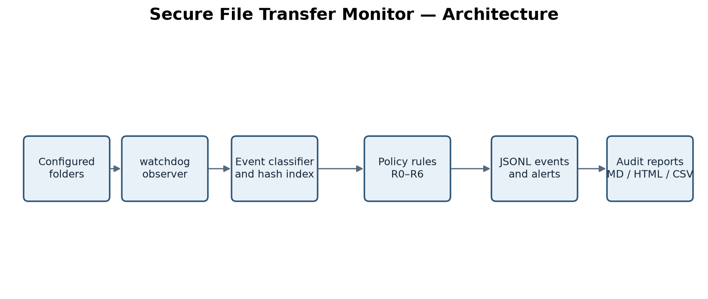
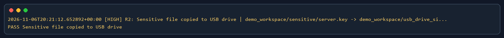
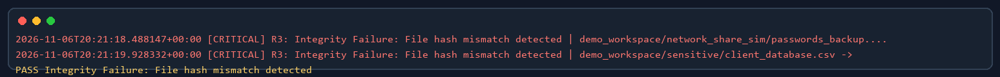
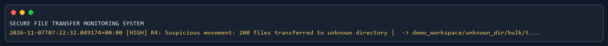

# Secure File Transfer Monitoring System

A local defensive monitor that records configured file activity, checks sensitive-file movement and SHA-256 integrity, and writes reviewable audit reports. The synthetic demo uses dummy files and makes no network calls.

Created by **Vansh Dhawan**, age 17, as part of his first internship with **Unified Mentors**.
Date:07/11/2026

## Features

- Recursive folder monitoring with watchdog.
- JSONL activity, human-readable alerts, and Markdown / HTML / CSV reports.
- Path-based sensitive, approved, USB, cloud, and network-share zones.
- SHA-256 checks, copy inference, user allow-list, and bulk-window alerting.
- Nine repeatable scenarios and automated acceptance checks.

## Architecture



## Quick start

```powershell
python -m venv venv
.\venv\Scripts\Activate.ps1
python -m pip install -r requirements.txt
```

Run the demo, tests, and report:

```powershell
python main.py demo --clean
python -m pytest -q
python main.py report
```

## Demo evidence

The latest frozen demo contains **210 event rows** (BULK=1, COPY=5, CREATE=200, DELETE=1, MODIFY=2, MOVE=1) and passed **16/16 checks**. Numbers are generated from the captured event log.







## Commands

| Command | Purpose |
|---|---|
| `python main.py baseline [--policy FILE]` | Build the hash baseline. |
| `python main.py monitor [--policy FILE]` | Watch configured folders until Ctrl+C. |
| `python main.py report [--policy FILE]` | Regenerate reports from the current log. |
| `python main.py hash FILE` | Print SHA-256 and MD5. |
| `python main.py verify SOURCE COPY` | Compare SHA-256; mismatch returns exit code 1. |
| `python main.py demo --clean --pace 3` | Run all cases with three seconds between scenario starts. |
| `python main.py demo --clean --no-color` | Run without ANSI color. |
| `python -m pytest -q` | Run automated tests. |
| `python tools/verify_all.py` | Check scenarios and acceptance output. |

## Configure real folders

Edit `config/policy.json` or pass a separate policy with `--policy`. Set watched and sensitive locations, approved backup folders, and external zones for a USB drive letter, OneDrive/Dropbox folder, or network share. Review `authorized_users` and `ignore_patterns`. The example policy uses placeholder paths; replace them before use. Do not point the demo at real sensitive files.

Example alert:

```text
[HIGH] R2: Sensitive file copied to USB drive
```

## Limitations

This tool detects and records activity; it does not block transfers. External zones are configured paths, not hardware identity or network inspection. Windows open/read auditing is not implemented. Process fields remain `unknown` here because psutil is unavailable. Filesystem notifications vary by platform and sync software. Windows was checked; test other systems before relying on them.

## Project structure

```text
main.py                 command-line entry point
config/                 active and example policies
src/ftmon/              hashing, monitoring, policy, logs and reports
demo/run_demo.py        synthetic nine-scenario demonstration
tests/                  unit and watcher checks
tools/                  acceptance and artifact generation
docs/                   report, presentation, diagrams, and guides
evidence/final/          frozen runs and verification
```

## License

MIT. See [LICENSE](LICENSE).
